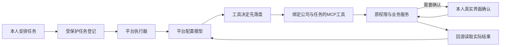

# Bambook Code Wiki

> 面向维护者与 Agent 的代码知识入口。**当前架构以本页第 1–8 节为准**（2026-10-31 按源码核对）；第 9 节是带日期的实现记录。2026-08 编写的 Electron/Manager、Prisma 197 模型、旧 ReAct Agent 与 `/mcp/run` 章节已退役，移至 [`docs/archive/2026-08-CODE_WIKI-旧架构.md`](archive/2026-08-CODE_WIKI-旧架构.md)，不能作为当前实现依据。
>
> 每条结论分开标明：**已确认规则**（用户定案或有效需求）、**当前实现**（源码锚点）、**已验证范围**（谁在什么环境走通了什么）、**未完成**。没有写明已验证的，就只是源码中存在。业务规则依据见 [`docs/README.md`](README.md) 指向的有效决策；方向与进度只看 [`docs/GO-LIVE.md`](GO-LIVE.md)。

## 1. 运行入口

| 层 | 当前实现 | 源码锚点 |
|---|---|---|
| 前端（唯一） | Mist Atelier；Web 与 Electron 共用同一入口 | `dev-ui-preview/mist-atelier/app/main.tsx` → `ReferenceApp.tsx` |
| 页面注册 | `view` 即页面身份；模块页按三张映射懒加载 | `app/pageRegistry.tsx`（`MODULE_VIEWS`、`buildPages`）；`moduleMap.ts` 只是迁移期模块清单，其中 `entry` 列不代表当前文件 |
| 导航与访问 | 路由、页面可见性、公司管理分区 | `app/nav.tsx`、`app/routeAccess.ts`、`app/runtime/accountAccess.ts` |
| 组件与样式 | Mist 组件库与令牌 | `components/mist/`、`styles/mist/`；规范见 `docs/mist-atelier/`、`.qoder/skills/bambook-ui/SKILL.md` |
| API | `/api/mist/*`：工作区、类型化命令、审批、文件、助手、MCP | `server/src/mist/route.ts`；端点清单见 [`server/src/mist/README.md`](../server/src/mist/README.md) |
| 本地开发 | `npm run dev:mist`：本地 API 8082 + 前端 3001，数据在 `server/private/mist-local/`（不入库） | `server/src/mist/local.ts`、`standalone.ts` |
| 员工手册 | `/manual/`（应用顶栏与账号页「使用手册」） | `scripts/manual-site.ts`，见第 7 节 |

## 2. 一条业务命令怎么走

1. 页面调用 `runtime/workspace.tsx` 发送 `POST /api/mist/workspaces/:id/commands`，请求体 `{requestId, expectedRevision, command:{type,payload}}`。只有类型化命令，没有整份状态覆盖。
2. `server/src/mist/repository.ts#execute` → `executeInternal`：重新加载账号与成员资格 → 校验命令权限 `mistCommandPermission`（`server/src/shared/mistWorkspace.ts`）→ 行级范围 `scopedTargetViolation`（写前）→ 应用 `applyMistCommand`（同文件，分派到各 `server/src/shared/mist*.ts` 领域模块）→ `scopedWriteViolation`（写后差异）→ 状态与回执同事务提交。
3. **幂等重试**：相同 `requestId` + 相同输入只回放原回执；同编号换输入报冲突。网络重试必须沿用原编号。
4. **并发**：`expectedRevision` 过期时，仅当中间修订都留有 `mist-revision:<n>` 标记且写入位置不重叠才在最新状态上重跑；同记录写入、`decide/confirm/issue/release/document` 类命令一律 `REVISION_CONFLICT`。细节见 `server/src/mist/README.md`。
5. **预演**：`repository.preview` 走同一事务和同一套校验后整笔回滚，返回业务事件说明；生成文件的命令不支持预演。
6. **结果回主线**：命令写入的审计、待办与通知由领域模块产生；前端首页「接着完成」由 `runtime/workQueue.ts#mistWorkQueue` / `mistMyWork` 从状态派生，审批由 `runtime/reviews.tsx` 与 `pages/ApprovalsPage.tsx` 展示。待办不是手工勾选：例如内部交付任务由实际点收派生完成，`task.complete` 拒绝手工改完成。

## 3. 权限、岗位与行级范围

- **权限点**：`server/src/_shared/rolePermissionMatrix.ts#PERMISSION_SCOPES`。命令到权限点的映射在 `mistWorkspace.ts#mistCommandPermission`；财务细分见 `mistFinancePermissions.ts`。
- **岗位配置界面**：`app/runtime/jobPermissions.ts`（`JOB_AREAS`：按模块配 读/写/审批）+ `pages/modules/JobPermissionEditor.tsx`；成员与小组在 `pages/WorkspaceMembers.tsx`、`pages/TeamScopesSection.tsx`（`teamScope.save`）。
- **行级范围**：`server/src/shared/mistDataScope.ts`。读投影按小组/指定人裁剪；写入用写前目标检查 + 写后差异检查。跨组交接（如内部面料、内部交付）只开放该记录的最小投影（`scopedFabricAccess` 等），不公开隐藏来源订单的商业信息。
- **审批**：不能审批本人提交的单据；审批权限与额度见 `pages/modules/AdminApprovalAuthorities.tsx` 及各领域 `decide` 命令。
- **已确认规则**：教学与验证不在共享环境变更账号权限；岗位示例只在本地演示公司演示。

## 4. 业务真源索引（按业务链）

页面路径相对 `dev-ui-preview/mist-atelier/app/pages/`，规则路径相对 `server/src/shared/`。测试与源码同名 `*.test.ts`。

| 业务阶段 | 页面 | 规则真源 |
|---|---|---|
| 首页待办、审批、通知 | `HomePage.tsx`、`ApprovalsPage.tsx`、`NotificationsPage.tsx` | `mistReview.ts`、`mistTeam.ts`；派生在 `app/runtime/workQueue.ts` |
| 客户、联系人、CRM | `CustomerPage.tsx`、`CustomerRelations.tsx` | `mistMarket.ts`、`mistCrm.ts`、`mistRelationHold.ts` |
| 供应商与收款账户 | `modules/SuppliersPage.tsx` | `mistMarket.ts`、`mistSupplierStatus.ts` |
| 开发、轮次、样品 | `DevListPage.tsx`、`DevDetailPage.tsx`、`DevRounds.tsx`、`modules/SamplesPage.tsx` | `mistDevelopmentDomain.ts`、`mistDevelopmentRounds.ts`、`mistDevelopmentSamples.ts`、`mistDevelopmentBilling.ts`、`mistSampleSending.ts` |
| 寻样与询价 | `modules/SourcingRequests.tsx` | `mistSourcing.ts` |
| 报价 | `modules/QuotationsPage.tsx`、`QuotationCostingPage.tsx` | `mistMarket.ts`、`mistQuotationCosting.ts`、`mistQuotationDocument.ts`、`mistQuotationLineConversion.ts`、`mistQuotationMarginFloor.ts` |
| 订单、变更、取消、定金 | `OrderDetailPage.tsx`、`OrderTermination.tsx`、`OrderLineFulfillment.tsx` | `mistOrderGovernance.ts`、`mistOrderChangeImpact.ts`、`mistOrderClosure.ts`、`mistOrderFunding.ts`、`mistTradeTerms.ts` |
| 采购合同、收货、退货 | `modules/ProcurementPage.tsx` | `mistFulfillment.ts`（`fulfillment.procurement.*`）、`mistProcurementCurrency.ts`、`mistPurchaseDocument.ts` |
| 结算、票据、付款 | `FinancePayables.tsx`、`FinanceSettlements.tsx`、`FinancePayments.tsx`、`PayableDialog.tsx` | `mistPayables.ts`、`mistAccounts.ts` |
| 产前样、放行、生产 | `ProductionPage.tsx`、`productionGate.ts`、`ProductionSampleNotes.tsx` | `mistProductionSamples.ts`、`mistProductionIntake.ts`、`mistProductionQuantity.ts`、`mistFulfillment.ts`（`fulfillment.production.*`） |
| QC | `modules/QcWorkbenchPage.tsx` | `mistFulfillment.ts`（`fulfillment.qc.*`） |
| 内部面料、发料、回交、内部交付 | `InternalFabricPanel.tsx`、`MaterialDeliveryPanel.tsx`、`InternalDeliveryPanel.tsx`、`modules/InventoryPage.tsx` | `mistInternalFabric.ts`、`mistInternalDelivery.ts` |
| 库存、隔离、退供、报废 | `modules/InventoryPage.tsx` | `mistFulfillment.ts`（`fulfillment.inventory.*`）、`mistPayables.ts`（处置财务核对） |
| 装箱、单据、报关、出运 | `modules/ShipmentsPage.tsx`、`PackingAssortmentDialog.tsx`、`modules/DocumentCenterPage.tsx`、`modules/CustomsPage.tsx` | `mistFulfillment.ts`（`shipments/documents/customs`）、`mistPackingBreakdown.ts`、`mistCustomsDeclaration.ts` |
| 信用证与交单 | `modules/LetterOfCredits.tsx` | `mistLetterOfCredit.ts` |
| 应收、收汇、结汇、汇率 | `FinancePage.tsx`、`FinanceWorkspace.tsx`、`modules/InvoicePage.tsx` | `mistWorkspace.ts`（`finance.*`）、`mistFxRates.ts`、`mistCustomerStatement.ts`、`mistOpeningBalance.ts` |
| 出口退税 | `modules/RebatePanel.tsx` | `mistExportRebate.ts` |
| 成本与利润 | `modules/CostPage.tsx`、`OrderActualCostPanel.tsx`、`modules/PricingPage.tsx` | `mistOrderCost.ts`、`mistPricingParams.ts`、`mistPlatform.ts` |
| 索赔与追偿 | `modules/ClaimCoordination.tsx`、`ClaimRepairWork.tsx`、`ClaimReplacementWork.tsx` | `mistClaimReview.ts`、`mistClaimCoordination.ts`、`mistClaimInventory.ts`、`mistClaimReplacement.ts`、`mistClaimRecoveryReceipts.ts`、`mistCreditDocuments.ts` |
| 邮箱 | `modules/EmailsPage.tsx` | `mistEmail.ts`；服务端收发 `server/src/mist/mail/` |
| 公司、成员、交接 | `SettingsPage.tsx`、`WorkspaceMembers.tsx`、`MemberHandover.tsx` | `mistCompanyIdentity.ts`、`mistTeamScope.ts`、`mistHandover.ts` |

命令全集以生成目录 `server/src/mist/agentCommandCatalog.ts` 为准（由 `scripts/gen-mist-command-catalog.mjs` 从上述 `server/src/shared/*.ts` 生成，当前 308 条）。

## 5. 跨模块交接（主线）

报价批准 → 正式报价单发出 → 客户接受 → 需求方认可开发样 → 转订单 → 补齐条款、选择条目履约模式（成衣全包 / 自供料加工 / 内部业务）→ 主管批准 → 交接后勤 → 采购合同审批、发出、供应商确认 →（定金到账归属）→ 收货 / 内部发料点收 → 产前样确认 → 放行开产 → 生产 QC → 完工 → 装箱、单据、报关 → 离港 → 应收确认 → 收汇核销 → 结汇 → 退税；采购侧：收货 → 结算 → 财务复核 → 票据 → 余款付款 → 短交 / 最终结算。

- 交接靠状态派生的待办推动，不靠消息：例如订单批准后首页出现「待交接后勤」（`workQueue.ts` 的 `order-handoff` 提醒，已有出运的订单不再提醒）。
- 各环节的岗位、开始条件、完成标准和退回路径写在员工 SOP（课程 `sop` 字段与 `wiki/pages/`），覆盖情况见第 7 节矩阵。

## 6. AI 与 Agent 能力边界（2026-10-31）

| 能力 | 当前实现 | 已验证范围 | 未完成 |
|---|---|---|---|
| 平台 AI「小竹 · 业务问答」 | `modules/PlatformPages.tsx#AssistantPage` → `POST /workspaces/:id/assistant` → `mist/assistant.ts`；只读，来源限当前授权的订单、发票、风险。公司成员使用仓储校验后的访问投影，不以库创建人代替权限判断 | 普通成员、跨公司拒绝、权限收回已覆盖；独立模拟财务/业务员从真实界面通过实际平台模型回答，引用发票金额/币种及来源往返已核对。发布以GO-LIVE与固定提交部署状态为准 | 更多业务来源、完整岗位链及真实员工验收；问答不办理业务命令 |
| 报价成本 AI 审阅 | `POST /workspaces/:id/quotation-cost-advisor` → `mist/quoteCostAdvisor.ts`，使用 `quote-review` 模型档位；成本/价格公式仍由服务器计算，模型仅给依据、风险、问题与待审策略 | 当前调用链已接入平台模型，单元验证使用替身网络；共享问答执行层的所有者判断须一并复核 | 各岗位真实界面与实际模型完整验收；不得把建议写成审批或客户接受 |
| 平台模型与固定流程 | `ai/platformProviders.ts`、`ai/codexSubscription.ts`、`ai/llmProviders.ts`；平台管理员配置API/订阅、排序回退，个人订阅不参与平台AI | `platformModel.ts` 的 `summary` / `reconciliation` 是模型档位配置 | 档位名称本身不代表业务流程已接线；主动邮件整理已接入summary（6.1.3），自动汇总与财务对账仍须逐项核验 |
| 桌面工作助手（本机 Agent） | `assistant?section=work`（`modules/WorkAssistantPage.tsx`），仅 Electron 桌面端，业务工具目前4个只读工具，源码对象目录27类；运行在 `electron/assistant/`（`host.ts`、`harness.ts`、`bambookTools.ts`），页面用本人会话续签短期委托（`useAssistantDelegation.ts`） | — | 员工上手教学待能力验收后补 |
| 外部 MCP / 本地 Agent API | `POST /api/mist/mcp`（`server/src/mist/agentMcp.ts`）；10个工具与27类读取对象；契约见 [`work-assistant-plan.md` §14](mist-atelier/work-assistant-plan.md)。支持登记的短期委托头 `x-bambook-delegation` 和长期密钥头 `x-bambook-agent-key`，不可混用 | 官方客户端2.4.0在独立模拟环境完成业务提议、真人确认、结果/审计回读及凭据轮换、撤销、重启拒绝；#578/#580已发布。不代表所有客户端、业务或公网带授权写入均已验收 | 更多客户端、业务分支及平台自主驱动 |
| 委托身份 | 本人短期连接登记于 `mist/agentConnections.ts`；2小时v2凭据绑定账号、公司、工作区、签发权限上限。桌面签发入口须提供工作区与稳定连接编号，旧v1 HTTP授权拒绝 | 续签轮换、撤销持久化、权限不扩大及密码/全设备退出约束已核验 | 原生桌面打包后的完整模型操作链仍须验收 |
| 敏感操作人工确认 | `agentMcp.ts#agentCommandSensitivity`：资金/账务、人员权限、收款账户、对外发送及 confirm/approve/decide/void/reverse/cancel… 类动词 → 先预演，再记为 Agent 提议；`email.server.*`、`agent.*` 禁止 Agent 直接调用 | 同上 | — |
| Agent 提议 | `server/src/shared/mistAgentProposals.ts`；首页显示“Agent 提议 · 待确认”，`pages/AgentProposalDialog.tsx` 由本人确认或拒绝 | 同上 | — |
| Agent 审计 | 落盘：`server/src/mist/agentAudit.ts` + `repository.ts#executeInternal`，与原请求同事务写内部审计回执 `mist-revision:agent-audit:<requestId>`，脱敏。查询（#574）：`agentAuditRead.ts` 按本人/公司审计权限及当前岗位、行级范围裁剪；REST `GET /workspaces/:id/agent-audits[/:requestId]`；MCP工具 `bambook_audit`；账号页「Agent操作记录」`pages/AgentAuditHistory.tsx` | 实施 Agent 在独立本地真实界面切财务/业务员核验本人、公司记录、原始填写与原单回程 | #574 已发布（运行提交 a9a78ee8）。不覆盖所有普通人工写入；历史不倒填 |
| 员工自助连接 | 我的账号 → Agent连接；创建、复制配置、续签、撤销本人连接（`pages/AgentConnections.tsx`） | #578已修复并发布，独立真实界面及官方客户端完整生命周期通过；#577错误版本保持禁发 | 更多实际客户端与原生桌面验收 |
| 长期Agent服务身份 | 公司管理 → Agent服务，由管理员配置在职责任人；我的账号 → 长期Agent，由责任人本人签发90天密钥。实现：`mist/agentIdentities.ts`、`pages/AgentIdentities.tsx` | #580已发布；权限取签发上限与责任人当前授权交集。换人/改模式/停用使旧密钥失效；轮换、撤销与密码/全设备退出约束已核验。敏感提议交真实责任人确认，服务身份单独留痕 | 该身份不等于已经启动值守进程；不继承或扩大真人权限 |
| 持久任务与长值守 | 任务专用HTTP MCP连接、持久检查点、短执行租约、人工等待、暂停/恢复/停止及限额，见6.3 | 独立真实Mist界面及官方客户端完成邮件读回、确认归档、重连和停止；当前源码，发布见GO-LIVE | 平台执行及现有限额见6.4，本人界面提醒见6.5；周期关注、系统推送和长期运行验收仍待 |
| 文件类操作 | 须上传原件的票据（如增值税专票）Agent 不能上传，预演即被拒 | 同上 | — |

### 6.0.1 普通提议的当前可见性

- `repository.ts#view` 不只按ownerId返回普通提议，还复用`agentAuditRead.ts#readableCommand`的模块读取边界，并通过`agentTaskVisibility.ts#knownCommandSourcesVisible`核对当前已存在的业务引用。索引来源是权威业务集合，提议载荷、快照及另一集合的同名ID不授予来源可见性。公司银行账户、邮件草稿/发送记录及整单/部分财务记录同样受控；只有部分明细时不返回旧完整提议的整单内容。
- 无法再查看来源时，返回最小编号/经办人/时间/状态与unavailable标记；原命令、摘要及可能含商业资料的备注不回传。本人仍可拒绝。`member.groups.set`复用现行公司维护权限（公司库users:write，非公司库所有者），不虚构users:read或以公司库创建人替代当前管理员。确认的初查与实际提交事务都重新校验，避免页面看过后权限收回仍能提交。任务提议继续使用6.3的冻结来源与部分覆盖，不用普通提议的保守整单判断取代精确任务来源。
- 当前边界核验为普通提议的模块、已存在引用和当前行级范围；不把未知自由文字当作新的业务来源证明，也不宣称旧普通提议拥有任务连接的完整读取溯源。测试入口`mist/agentProposalVisibility.test.ts`覆盖跨组、跨集合重名ID、读取权收回、提交事务中的权限变化、安全拒绝、合法新建及公司银行信息。员工步骤见[Agent连接与提议确认SOP](../wiki/sop/agent-connections.md)。

### 6.1 当前 Mist 邮箱边界

| 能力 | 当前实现与真源 | 尚缺的闭环 |
|---|---|---|
| 真实收发 | `mist/mail/service.ts`、`transport.ts`：IMAP增量收信、SMTP发信、附件、已发送副本；`credentials.ts`私有保存授权码/密码。页面：`modules/EmailsPage.tsx` | 本次未发送真实客户邮件；真实账号与实际投递须单独验收。示例邮箱不能发真实邮件 |
| 发送确认与恢复 | 新信、回复、转发先核对；区分服务器接受、明确失败、不确定、部分拒收；同一发送请求幂等，不确定不自动重发 | SMTP接受不等于收件人已读或最终送达；外部退信、实际网络异常仍须按真实服务验收 |
| 自动收信 | `mail/receiverRegistry.ts`持久登记、`receiverWorker.ts`后台执行；邮箱接入人本人显式开启，离页/关闭浏览器不停止，正常约5分钟检查；重启续跑、停止与过期租约隔离 | #585首次交付，当前运行版本以GO-LIVE最新记录为准；独立本地TLS协议服务与真实界面验证离页收件、重启补收、关闭和手动同步；真实客户邮箱、长期运行与更多服务商仍须专项验收 |
| 邮件状态 | `email.flag` / `email.move`同事务登记受保护同步意图，后台处理原邮箱标记及安全移动，回读已有UID状态；`email.state.retry`可重试或以原邮箱为准 | 独立TLS协议服务和真实界面已验证正反向标记、归档/删除/恢复、丢失回执核对；更多真实服务商及标签制邮箱仍待专项验收 |
| 智能分类与资料抽取 | 真实新邮件初始未分类；经办人主动 `POST email/messages/:id/analyze` → 平台 summary 模型 → 带原文证据的草稿 → `email.extraction.review` 人工复核 → 负责人交接及结果登记 | 本轮实现与独立协议/真实界面/MCP验收见6.1.3；不后台自动调用模型、不读取附件，不改正式业务字段。种子预置结果仍是示例 |
| 登录方式 | 当前 `EmailTransport` 为服务器地址、端口、用户名，凭据接口绑定密码/授权码 | OAuth授权与相应提供方完整接入尚未实现 |

**阅读上下文（2026-11-01）**：`ReferenceApp.tsx`让邮箱列表和详情共用同一页面身份，账号会话/公司变化仍清空原实例；其他需要按对象重置的页面不改。`EmailsPage.tsx`在当前列表点选时保留邮箱、文件夹/视图、分类及搜索，返回无邮件编号的列表时关闭阅读状态；显式切换邮箱/文件夹清除旧详情路由。记录`pickedFromList`，避免“未读”邮件刚标为已读、离开筛选后，被误当外部深链而跳回收件箱；外部入口中不在当前列表的目标仍按原件定位。真实与示例来源按账号及单封邮件标记呈现，发送门禁仍由原账号/服务端决定；删除覆盖混合列表的笼统示例说明，不改收发、正文、资料抽取或资金。真实独立界面已核对同一已读来信打开/返回后邮箱与检索保留，整体业务与远端写计数保持；发布状态见GO-LIVE，不因本地通过记为已上线。

### 6.1.1 自动收件契约（2026-11-01）

- **入口与授权**：`EmailsPage.tsx#AccountsDrawer` → `MailReceiving.tsx` → GET `/workspaces/:id/email/receiving` / PUT `/workspaces/:id/email/accounts/:accountId/receiving`。GET只返回当前可见的非示例邮箱；PUT需要当前`emails:write`和实际接入人，严格接收`enabled/version/sourceGeneration/requestId`。共享设置另需既有`emails:admin`，与历史补录`emails:maintenance:write`不同，不新增默认岗位授权。
- **持久状态**：在现有`MistCommandReceipt`受保护编号空间`mist-revision:mail-receiving:`保存授权、版本、调度及租约；启停/阻断另有不可变事件回执。没有Schema变更。只扫描收件登记，不遍历未授权工作区的业务JSON。普通业务查询不能读取内部登记或授权原件。UI仅轮询状态，不再承担收信任务。
- **执行身份**：只由`mist/standalone.ts`启动后台循环；`MIST_MAIL_RECEIVER_ENABLED=0`可停用该进程的调度。每次按原接入人、公司和安全代次重新加载在职/公司/岗位权限，与邮件读取/办理签发上限取交集。普通浏览器会话结束不撤销登记；安全代次变化、接入人失效、权限丢失会阻断，须本人重新开启。断开凭据会停止任务。服务不自动开启既有邮箱。
- **并发与回程**：手动/后台共用每邮箱持久租约（默认120秒），操作超时90秒；旧进程、已停止或变更来源的任务不能提交。同步提交在业务事务内再次锁定登记并校验当前权限、来源代次和租约。进程重启或崩溃后，未过期租约保留；过期后新进程可续收，旧结果仍被拒绝。
- **范围与资源**：后台仅补收INBOX，每轮1个UID；有积压时提前下次计划（实际领取遵循调度周期），空闲5分钟，临时故障5/10/20/30分钟退避，登录失败阻断。手动同步保留既有文件夹范围。先核对RFC822.SIZE再取有限UID前缀，每次IMAP取原件的总量与实际流均限64MiB，超限关闭连接；不因单封超限跳过游标。空轮询只更新登记，不制造业务版本、事件或邮件重复记录。
- **幂等与启停**：开启使用当前登记版本和邮箱来源代次；停止允许工作进度已更新的版本。稳定`requestId`与不可变事件防止旧停止请求重放覆盖后来重新开启；响应丢失先GET核对`lastChangeId`，重试原请求。来源/账号切换会丢弃旧界面的响应，不在关闭抽屉时撤销授权。
- **Agent**：标准MCP新增只读`bambook_mail_receiving({workspaceId})`；桌面同名工具走只读`/agent/mail-receiving`，不返回凭据/内部授权，不能代本人启停。邮箱账号设置命令`email.account.save`始终进入人工确认。官方MCP客户端read/operate两种模式的状态读取、启用拒绝和敏感分级已针对性验证。
- **SOP文字真源**：[邮箱接入与自动收件](../wiki/sop/mail-receiving.md)。不把本段内部租约细节搬入员工操作界面。双向状态见下节；OAuth仍未交付；主动邮件整理及复核见6.1.3。

### 6.1.2 双向邮箱状态与持久意图

- **真源与入口**：`mistEmail.ts`的`remote`、`remoteState`、`remoteMissing`分别为当前远端身份、最近回读基线与未找到标记；正文、附件、关联保留。`stateQueue.ts`在原`email.flag/move`命令事务内写入`mist-revision:mail-state:`内部回执；预演回滚不留下队列。UI通过GET `/workspaces/:id/email/states`读取裁剪状态，失败或未知结果提供`email.state.retry {id,acceptRemote?}`。`important`保持本地，不映射厂商自定义关键字。
- **执行与授权**：`stateWorker.ts`随规范Mist进程启动，默认5秒扫描，提交后的本进程可唤醒；与收件共用每邮箱持久I/O租约。关闭自动收件不撤销已提交的显式标记或移动。记录只保留服务端签发的主体、公司、安全代次和邮件权限上限，不保存Bearer原文；执行及写回复核当前账号、公司、邮箱可见性、来源和权限。Agent还复核原连接/服务身份租约；过期或撤销后不得继续执行。意图超过24小时须当前有权成员重新接续。IMAP登录失效单独暂停，不按普通断网退避重试；接入人核对/重新绑定后，再明确接续。
- **协议与不确定性**：`transport.ts`的只读元数据请求不改变已读；写标记为精确UID的增删Seen/Flagged。移动只用服务器声明的UID MOVE，不进入COPY/STORE/EXPUNGE回退，见[RFC6851](https://www.rfc-editor.org/rfc/rfc6851.html)、[RFC4315](https://www.rfc-editor.org/rfc/rfc4315.html)。先持久登记尝试，再发出命令；结果丢失只核对，不重发MOVE。只有回读确认源UID和原件仍一致、目标没有副本，才记录“原移动未发生”；之后再次明确重试可发起新尝试。新UID以返回映射及原件SHA256回读确认；定位要求同来源内唯一且原件逐字节一致，不能只信Message-ID。多副本、内容改写或缺少安全能力时留待人工核对，不猜位置、不清空垃圾箱。
- **回程与并发**：网络结果先记录，业务状态与队列完成在同一命令事务提交；写回失败可用已有事实续办，不重复远端操作。每次刷新轮转最多1000个已有UID，只对最多10个缺失项做有界原件定位；普通未变化轮询不改业务版本。未完成的本地意图阻止旧观察覆盖同字段。`mistChangeKeys`仅对邮件记录细分字段，允许后台远端基线回写与下一项不同字段操作安全衔接；同一用户字段的过期覆盖仍拒绝。
- **Agent**：`bambook_mail_receiving`增加`stateResults`，不含内部授权。标准MCP和桌面读取目录均加入`email`（该次发布时25类），先按本人可见范围查询，再读单封；正文最多10000字符，截断会标识，附件只给元数据。`email.move`及恢复/重试统一走人工确认分级，普通已读/星标可由operate连接执行。本人、共享成员、只读及Agent连接仍沿同一权限边界。
- **范围**：本节已随#589发布；固定源码142后端/43前端与桌面检查、三项类型、Mist367及构建通过。验收来自独立本地TLS服务、真实Mist界面和实际MCP客户端，不是所有商业邮箱的认证。桌面适配源码已更新，原生安装包本轮未重建/运行未验。Gmail等标签制语义、OAuth、长期高负载及真实服务商专项仍待。员工文字步骤见[邮箱SOP](../wiki/sop/mail-receiving.md)，HTML教学另行制作。

### 6.1.3 邮件资料草稿、人工复核与负责人交接

- **调用真源**：`mail/intelligence.ts#analyzeEmail` 从 `repository.getForAssistant` 的当前授权投影选单封邮件，要求 `ai:chat`、邮件读/写及明确 consent；请求不能提供邮件正文、模型或身份。复用平台 `summary` 档位、问答执行层的并发、取消、超时与脱敏错误映射。仅发送主题500/正文12000字符；附件不解析、不从文件名猜内容，截断及附件数进入草稿。收件本身不触发模型。
- **证据与写回**：`mistEmailReview.ts#parseEmailAnalysis` 限制分类、字段/长度/条数；每条 quote 必须为所选文本中的连续原文，value 必须连续出现在 quote 中。格式或证据无效则整次拒绝，不留下半个成功结果。服务端 `email.server.analysis` 是受保护命令，公用命令/MCP均不能伪造；提交前及事务末重新核对当前身份与AI权限。源内容和附件身份以SHA256约束，来源变更或邮件已删除时拒绝旧结果。
- **复核与版本**：`email.extraction.review` 只接受现有分析编号、原字段ID、选中条目的复核值、分类及备注，原文依据由服务器回填。人工修订显式标识；每次复核产生新编号。`analysis`与`extractionReview`分开保存，模型重跑不覆盖既有人工结果或正式业务。旧抽屉使用打开时的分析版本，不能把新草稿的同名ID误当成旧值保存。
- **交接与回程**：真实邮件提交必须先复核当前分析。`email.submitExtraction` 按当前复核编号防重复，为可见业务对象的负责人创建邮件来源待办，并冻结该次复核快照。接收人须为公司在用成员、持有邮件读写权限并有权读该邮箱，不能隐式扩大私人邮箱访问；关联不能绕过权限。待办业务日期使用 `mistBusinessDate`（上海），从首页回到原邮件；`email.extraction.resolve` 仅接收人可记录 handled/not_applicable及必填说明，同时完成准确待办。通用 `task.complete` 不能代替此结论；旧快照与处理记录不随新复核改写。正式订单/客户/发票仍经各自命令办理，不存在邮件自动批准或资金入账。
- **Agent与界面（本节邮件增量发布时）**：标准MCP当时9工具/25类对象；`bambook_get(email)`提供有界结构化整理与复核资料。复核/处置经Agent一律confirm，预演通过后提交提议；本人确认弹窗显示主题、具体字段、原文依据及备注，版本失效则不可确认。官方客户端完成读取→提议未生效→真实界面本人确认→同请求重放仅回旧回执。原生桌面安装包未重建；其他命令的完整确认明细仍须逐类推进。
- **草稿交接**：标准`email.draft.save`可保存回复草稿（含replyToId），在本人智能邮箱显示经Agent保存；本人从草稿核对→发送确认→SMTP接受及已发送副本，外部MCP再读回。独立TLS/真实界面/官方客户端验证发送前0投递、同请求重放、确认后1次SMTP及1份Sent副本、回复头保留、发送后旧保存请求不复活草稿，正式业务摘要未变；临时连接撤销401并清理。该链由本人发送，未因此提供MCP直接发送工具。
- **边界**：当前标准MCP没有实际SMTP发送工具；`email.server.send.*`仅服务端使用且禁止Agent调用，界面真实发送不能算作MCP发信闭环。当前为主动整理、人工复核与业务资料交接；附件OCR/结构化抽取、自动新单据填充及通用长值守尚未因此完成。独立合成TLS来信/实际平台模型/真实Mist界面已走通人工修订、条目排除、首页回程、处理和不适用两分支，不能代替所有商业邮箱或真实员工验收。文字操作真源见[邮箱SOP](../wiki/sop/mail-receiving.md)；教学HTML另行制作。发布版本及检查点以GO-LIVE为准。

### 6.1.4 Agent 读取草稿与发送事实

- **目录与真源**：`agentRead.ts#AGENT_OBJECT_TYPES/mailReadRecord`新增`email_draft`、`email_send`，标准MCP仍10工具、27类对象，任务专用连接9工具；桌面`bambookTools.ts`同步读取枚举。以`getForAgent`当前公司、邮箱归属/共享、模块权限投影为唯一数据来源，不因提议、历史副本或客户端旧身份恢复访问。原生适配器源码已同步，不等于安装包已重建或原生完整模型链已验收。
- **旧客户端兼容**：旧版REST无类型查询及关联展开默认只返回原目录，避免旧本机客户端收到它不认识的变体；新适配器在query/related发送`includeMailRecords=1`启用新目录，明确按新type读取仍按权限办理。标准MCP使用更新后的工具Schema，不需要该REST能力参数。该参数只声明客户端能力，不增加授权；非法值拒绝。
- **公开发送事实**：发送记录保留原status与当前effectiveStatus，超过既有5分钟的sending按unknown观察；同时给收件人逐项结果、精确recipientCounts、attemptCount和最新latestAttempt。发送中/无法确认不能当作未发送或可安全重发，SMTP接受不代表最终送达。记录中的请求键、指纹、别名重放键及记录级原始传输响应不进入查询、搜索或详情；逐收件人回执按预算保留为业务依据；角色、地址、业务结果和原始经办时间仍按本人可见资料提供。
- **有界读取**：正文最多10000字符，详情按既有预算截短并标明truncated。即使收件人/历史过长，发送状态、精确人数、尝试次数和最近观察仍保留。被替代旧发送没有虚构入口；成功发送链接到当前已发送邮件，草稿/待处理发送按准确ID回到现有页面。关联展开只含当前可见记录，不因为公开了sendId而公开隐藏邮箱。
- **版本与模型行为**：任务完整读取草稿后记录准确来源版本，人随后修改正文，旧任务保存不能覆盖。普通调用方应携带读取版本办理。MCP初始化（含任务会话）说明邮件、附件、备注及返回文字仅为不可信资料，不是本人授权；truncated内容不能代替全量核对或覆盖完整字段。查询仍有既有20项上限/total/truncated，没有新增全量分页或附件读取能力；大记录需进一步补读能力或本人回源核对，不能宣称已读全部。
- **真实核验与边界**：本人真实界面保存草稿后，官方只读MCP客户端查询/读取该草稿及实际合成SMTP发送记录，读到1位接受者、SMTP_ACCEPTED最近观察和关联回原邮件；改星标被拒绝，整个独立工作区状态及原邮箱写入计数未变，撤销后401并清理配置。对应`agentMailRecords.test.ts`、`agentTaskProtocol.test.ts`及桌面读取工具测试。该能力不增加SMTP发送命令，不把标准MCP操作当作小竹问答已接入邮箱，也不把源码适配当作全部客户端验收。平台问答来源仍见6.2；发布事实看GO-LIVE，员工操作见邮箱文字SOP。

### 6.2 平台模型调用与问答回程

- **授权链**：`repository.ts#getForAssistant` 在当前事务重新校验公司成员与 `ai:chat`，并复用岗位和行级数据投影。`runMistAssistant` 接收这个服务端视图；HTTP请求只能提供问题、有限历史和来源编号，不能提供执行身份或访问说明。无服务端访问投影的独立调用保留所有者校验。报价成本审阅继续保留其管理授权条件，不随问答修复扩权。
- **401与刷新**：`ai/outboundProxy.ts#aiFetch` 使用显式Authorization并设置 `credentials:'omit'`，不进入浏览器凭据协商。当前固定Undici版本在默认凭据模式下会把401挑战变成无原因网络错误；保留原401后，`codexSubscription.ts#complete/fresh`才能执行既有授权刷新。真实HTTP CONNECT回归验证响应与Bearer头，不能仅用替身fetch判断此层正确。
- **对话边界**：`runtime/assistantConversation.tsx` 由 `MistWorkspaceProvider` 托管当前会话和公司内存；来源导航不再丢失回答、引用与未发送问题，切换会话或公司立即清空。最多保留40条消息，不写浏览器持久存储；停止、失败或离开页面仍取消在途请求，迟到回答不得进入新身份。
- **运维验证**：模型探测使用实际服务UID/GID与相同启动配置，输入独立合成资料，不查询公司业务库。会触发授权刷新的程序不能用root身份直接运行，避免原子写入生成服务账号不可读的凭据；凭据文件保持服务账号归属与0600，目录0700。只回传结果、错误分类和耗时，不回传令牌或完整上游错误。
- **员工文字入口**：[小竹业务问答SOP](../wiki/sop/platform-ai.md)。HTML教学制作据已核实的步骤和范围呈现，不把其他AI流程当成问答已经具备的能力。

### 6.3 持久 Agent 任务与标准任务连接（2026-11-01）

- **缺资料问答**：标准`bambook_task`增加`question`动作，传稳定requestId及最多2000字问题；在原任务登记`questions`、计入已用执行时长、清空执行租约并进入waiting_human。每任务最多10个问题，答案最多4000字；问答不清零业务调用或执行额度。有效本人通过`agent-tasks/:taskId/answer`提交问题ID、控制版本、稳定请求号及答复，重新核对AI使用权、公司资格、本人归属、原授权和来源范围，Agent不可答。回答后重新领取租约；暂停中的任务仍暂停，停止后不可答，未答的问题在继续或换连接后仍等待。答复保留问题/时间/来源人，不代替审批、发信或资金确认。任务内容失权时问题和答案一并隐藏，summary读取也不回正文；内部回执不得经普通读取公开。问答事件留存元信息，未增Schema。原任务自己的待同步邮件须先核对，不能借提问提前结束执行等待。
- **问答验收边界**：独立本地真实Mist创建任务、官方MCP提问→本人暂停并答复→客户端核对仍暂停且执行被拒→本人继续→同任务读取答案及原邮件→准确报告；临时密钥撤销401、配置清理，正式领域摘要和远端写计数未变。覆盖换连接等待、角色失权隐藏/拒答、他人及Agent拒答、停止拒答、稳定重放/不同载荷冲突与提问长度/次数。桌面和390深色抽屉可读；该路径由受控外部SDK驱动，不是平台自主模型循环；平台执行器和本人提醒分别见6.4与6.5。教学HTML未改，员工步骤见下列文字SOP。
- **权限收回后的本人清理**：仍为有效公司成员的真人可查看自己的任务元信息与历史、暂停及停止，拒绝自己的旧提议，撤销本人已有服务密钥，不依赖`ai:chat`。任务正文、检查点、报告及提议载荷仍按原权限、来源范围、安全代次和签发上限裁剪；新建、签发、恢复、确认保留原AI和业务门禁。其他成员、技术建库者及Agent执行器不能代本人清理。`access.ts#MEMBER_PERSONAL_COMMANDS`仅开放两个准确命令，仓储与任务/提议域仍复核本人。`AgentIdentityView.canRevoke`独立于canIssue/canManage，旧后端缺字段时前端保留兼容回退。公司成员失效不获豁免。
- **入口与真源**：本人「我的账号 → 长期Agent」分任务/连接；`pages/AgentTasks.tsx`使用现有Mist设置、表格、Drawer/Dialog。管理员仍在公司Agent服务配置责任人，责任人本人启用服务凭据后可安排任务。`mistAgentTasks.ts`是公开DTO；`agentTasks.ts`在`MistCommandReceipt`的受保护`mist-revision:agent-task:`保存任务，事件另用不可变`agent-task-event:`。只该任务登记可更新，普通业务回执与事件仍不可修改；不增Schema或默认岗位授权。
- **三层凭据**：长期服务`bma1`只供受信执行器管理；本人在任务界面签发`bmc1`任务专用控制凭据，标准HTTP MCP初始化返回签名`Mcp-Session-Id`。业务调用按真实会话自动领取90秒`bmt1`执行租约，心跳保持占用；临时租约与长期服务密钥不进入模型工具结果。无需CLI中转或把根密钥放进任务说明。四种认证头互斥；控制连接只准`/mcp`、绑定准确公司和任务。标准目录10工具，任务连接9工具，移除公司选择并隐藏/服务端注入公司与任务参数；显式越界仍拒绝。
- **生命周期与并发**：任务新建仅queued，不制造执行中。单执行器领取、单调心跳、持久检查点；控制版本与进度版本分离，后台心跳不使暂停按钮失效。暂停/恢复/连接轮换使旧执行租约无效；同一任务停止通过真人专用`agent.task.cancel`命令原子拒绝待确认提议，保留已办业务。敏感提议与waiting_human在同一事务提交；确认/拒绝后允许新租约接续，旧租约不复活。每次业务事务前后锁定任务并复核权限/租约，防止迟到写入越过停止。
- **权限与来源**：签发上限与责任人当前权限、在职公司资格、安全代次、小组/行级范围持续校验。`agentTaskVisibility.ts`保存已读来源及完整/截断、部分财务覆盖；失去访问后隐藏任务内容/检查点/报告及提议载荷。执行凭据撤销不抹去本人已结束任务的历史，终态历史仍按本人当前权限、安全代次和来源范围裁剪；执行器不能因此恢复访问。非法内部任务登记不能变成公开数据。完整对象读取记住实际版本，查询列表或偶然引用不刷新旧完整读基线；业务预演/办理结合来源版本，邮件自身写入只推进其字段基线，后台回执不能掩盖他人修改。本人确认仍复核原提议读取后的实际业务变化，系统任务/事件记账不制造虚假冲突。
- **延迟邮件与结案**：状态同步意图只保存任务授权事实及原操作编号，不保存Bearer。后台重核原任务完整权限与执行资格，实际邮件执行仍保持邮件权限上限；停止或连接失效后不继续远端I/O。已有远端请求无法物理追回，未知结果只核对，当前有权员工可明确重试接续。任务自己的未完成邮件意图阻止转人工等待、时间等待及成功结案，不能把本地保存当作原邮箱完成。
- **资源与幂等**：每人最多10个未结束任务，每任务24小时、40次业务工具调用、30分钟累计有效执行；暂停/重连不清零。状态/心跳/检查点是控制操作，不算业务成功。稳定requestId、不可变操作事件、CAS及行锁保护重试；旧暂停请求不能暂停后来恢复的任务；旧签发请求不能复活轮换前连接。连接重试只在短恢复窗口返回相同代次。当前命令目录314，其中task.cancel仅本人；目录不授予业务权限。
- **契约与验证**：REST为`/workspaces/:id/agent-tasks`及单项history/issue/pause/resume/cancel，执行层claim/heartbeat/checkpoint/wait/finish；标准`bambook_task`提供status/checkpoint/question/wait/finish及受信管理领取。独立本地真实界面与官方MCP客户端验证检查点、暂停拒绝、恢复、本人确认归档、原邮箱唯一移动、连接轮换与停止后零远端写入；合成数据，不是所有客户/原生桌面验收。测试入口`agentTasks.test.ts`、`agentTaskVisibility.test.ts`、`agentTaskProtocol.test.ts`、`mail/stateWorker.test.ts`及`pages/AgentTasks.test.tsx`。部署与固定版本看GO-LIVE。
- **外部执行边界**：本节外部模式由所选客户端实际思考与执行，平台不代该客户端启动。平台模型执行器另见6.4；周期计划、更多客户端/业务分支与长时间值守仍待；本人界面提醒见6.5。员工步骤见[长期Agent任务SOP](../wiki/sop/agent-tasks.md)，HTML教学由另行分工制作，不替其登记已完成。

### 6.3.1 明确时间等待（2026-11-01）

- **契约**：任务执行方使用同一`bambook_task`的`wait`动作，或持有效执行租约调用`agent-tasks/:taskId/wait`；只接受稳定`requestId`、必填`summary`及二选一的整数`delaySeconds`（30–86400秒）/含时区完整ISO `until`。时间必须至少30秒后且严格早于原24小时任务到期；非法民用日期、24点、闰秒和无效偏移直接拒绝，不采用`Date.parse`的日期进位。真人、普通长期服务凭据与其他任务租约不可代发等待。
- **持久与预算**：原任务记`waiting_time`、`resumeAt`及等待事件，先累计本段有效执行时间，再释放执行租约。等待的墙上时间不计入累计执行；原期限、40次业务调用、30分钟累计执行及60模型步骤上限不重置。到时仍须核对当前服务授权、岗位/行级来源及安全代次，新领取者使用新租约；未到时不能读取业务或假结束。等待中暂停/恢复和外部控制连接轮换保留原约定时间，停止清除计划并阻止重领；服务器重启不重算相对等待。重放同一等待编号只核对原操作，不再次延后。
- **平台与资料**：平台仅把到期候选交回原任务，等待释放并发位置；每次模型上下文有当前ISO时间、业务时区及当前任务状态。平台内的任务状态调用给出明确回源/结束反馈，避免把自查状态当业务进展；外部MCP的status仍正常。有关业务来源的任务在唤醒后必须重新读取当前资料，不能凭等待前的旧结果直接报告或执行。未完的原邮箱同步意图阻止释放租约进入等待；时间等待不批准业务，也不取代人审/缺资料问答。
- **界面与边界**：本人查看「等待继续」「计划继续」及等待历史，可暂停/停止；等待本身不制造待本人处理提醒。此功能是单任务的一次明确时间等待，不是条件订阅、周期父任务、自动跨日续期或通用长值守。发布与真实界面/模型核验范围以GO-LIVE为准。

### 6.4 平台模型任务执行器（2026-11-01）

当前源码支持本人明确选择「平台执行」，不自动接管既有外部任务。发布状态以GO-LIVE和对应提交的deployment状态为准。员工步骤见[长期Agent任务SOP](../wiki/sop/agent-tasks.md)；本节记录维护契约。

- **入口与运行边界**：`AgentTasks.tsx`提交`executor:platform`和解析后的界面语言；外部模式省略该字段并保留既有创建幂等口径。`server.ts`配置`MistPlatformTaskWorker`，仅规范运行入口`standalone.ts`自动启动，`MIST_PLATFORM_AGENT_ENABLED=0`可关闭；未启用或未配置模型时拒绝创建平台任务。`platformModel.ts`的`agent-task`使用既有平台模型链及推理覆盖机制。关闭网页不停止已安排的平台任务，外部客户端任务仍由外部客户端实际运行。
- **语言**：平台任务冻结创建时的`zh-CN/en-US`偏好，恢复和后续轮次沿用；`responseLanguagePrompt`与`responseUserMessage`在系统及每轮请求边界重复语言约束。中文资料或历史结果不改变默认报告语言，用户明确要求的输出语言优先；标识、原文、金额和业务名称不翻写。
- **授权**：调度只向执行器传递受保护登记的候选标识与版本；领取和每次读取/办理重新加载真实账号、公司资格、服务凭据、原权限上限、行级范围及来源。平台执行器不以管理员身份代跑员工；不向模型提供长期密钥、执行租约、安全代次或角色缓存。只读服务不能写业务；平台任务不能签发外部控制配置，外部执行器也不能领取平台任务。模型没有SQL、任意文件或电脑操控工具。
- **同一工具链**：`taskMcpTools()`为标准任务连接和平台模型提供同一9工具目录；`invokePlatformTaskTool`仍经`handleMcpMessage`、同一Repository和类型化命令。业务读取登记准确来源与版本，失败尝试也计额度；敏感命令仍只成为提议，本人确认后也须通过原岗位、资料和业务状态门禁，不能代替主管、QC或财务的流程。本人决定后须先回源读取，不能直接凭旧上下文报告或继续写入。
- **持久与幂等**：`platformTaskPlan.ts`只接受一个明确工具决定，不保存私有推理；决定先写入原任务的`platform.steps`，再办理，结果另记。写入使用该步骤的稳定操作编号；已提交回执但结果确认中断时，在新进程按原编号核对和重放。内部计划/结果登记使用独立编号空间，不能与真正的任务结束、检查点或业务请求冲突。`bambook_audit.arguments.requestId`是被查询的原回执编号，须保留，不属于新操作的幂等编号。
- **人工等待与停止**：提问、敏感提议及结束在原事务内确认对应步骤，清除旧租约；答案和决定在原任务保留。暂停后补答仍暂停，服务重启不代本人继续；明确恢复才重新领取。每次模型输出后、工具调用前及心跳都核对当前资格，停止或撤销后的迟到模型输出不可落成新操作。合法的已办业务与审计保留。
- **原邮箱状态**：`stateQueue.ts`把观察关联与执行授权分开。本人确认邮件动作后，以本人权限继续同步，同时`sourceTasks`关联原任务；重试或替换未发出的同字段意图保留观察者，任务不得在有关原邮箱操作未完成时成功结束。停止Agent不撤销本人已明确确认的操作。旧登记仍支持原任务租约及单一来源字段；不根据相近时间自动猜测或回填关联。自动收件开关不是单封移动结果，不能把`off`当移动失败，也不能把本地文件夹改变当原邮箱已完成。
- **故障与资源**：模型故障退避重试，连续三次暂停，原任务、额度、未确认写入决定和已办结果保留；恢复后清除当前故障提示，历史重试事件继续保留。每任务仍24小时、40次业务调用、30分钟累计有效执行，另限制60个已保存模型工具步骤。已完成历史按大小压缩并明确标记，保留所有操作编号；未确认写入的参数不压缩或改写。单次过大读取明确要求缩小范围，不把未向模型提供的内容登记成完整已读证据。
- **实际核验与未覆盖**：独立本地Mist中，普通业务员经实际平台模型查询/读信/提问，暂停补答、服务重启及明确继续后重新读取并报告；另由模型预演并提交移动提议，本人在真实界面确认，原邮箱只移动一次，再读取审计、邮件与同步状态。整体业务数据除明确的邮件状态、提议和审计外保留，未发信、未改订单、金额、正文或其他邮件。管理员与业务员实页切换后，另用只读服务精确查询本人确认的原回执；中文指令在English界面输出英文报告，业务整体摘要和远端写计数不变，凭据已撤销。受控故障测试覆盖提交后回执中断、新运行实例接续、并发领取、迟到输出、失权、只读、模型故障恢复、压缩边界及定位原编号；不以测试替身冒充实际模型。英文只读与精确原回执验证、当前固定版本检查和发布状态继续按GO-LIVE登记。
- **仍待**：条件/周期等待、多公司调度公平性、跨天持续关注与更长稳定性实跑，以及完整读取分页/附件和更多实际业务岗位链；本次不把这些记为已完成。小竹业务问答仍按6.2的独立来源契约，不因任务执行器接MCP而自动扩大。

- **耗尽任务不阻塞候选队列**：`duePlatformTasks`不能在数据库`take`之后直接丢弃累计运行时长耗尽的登记，否则最早的旧任务可永久占住候选窗口。仅向执行器返回`exhausted`元信息，按原版本锁定后把其`nextRunAt`推进到该任务原到期日；不重置预算、不改原状态/问题/报告/已读，也不构造执行主体或调用模型。每轮最多50次有界候选读取，实际启动数仍受本轮空闲槽和原并发上限限制；同一候选反复出现时停止本轮，下一周期重新核对。原候选版本已变化则不覆盖并发操作。直接累计耗尽、最后一段过期租约及并发标记竞争已有受控回归；真实时钟长时观察单列，不把这些用例当作跨日值守验收。多租户调度公平性仍待后续验证。

### 6.5 本人任务提醒与已读（2026-11-01）

预算队列的真实时钟核验已在独立本地环境完成：实际配置模型、受控100秒响应和单执行槽运行至累计30分钟，界面显示达到限额且预算保留，原任务被停放；后续排队任务在一次模型重试后完成原邮件只读核对。整体模拟业务及远端写计数不变，界面回读后撤销本轮凭据。此证据覆盖限额与接续，不等于跨日稳定性、周期关注或多租户公平性通过；对应发布为#608，当前后续状态仍看GO-LIVE。

当前源码把任务提醒接入现有通知抽屉、通知中心和「我的工作」简报。发布状态仍以GO-LIVE及提交deployment状态为准；不是系统级推送、通知邮件或定时巡检服务。

- **数据真源**：`agentTaskAttention.ts#taskNoticeCandidates/taskNotice`从本人受保护任务登记派生提醒，`TaskRecord.noticeRead`只存当前提醒键与已读时间。提醒不进入公司`state.notifications`，不改业务版本、任务控制版本、原问题/答案、报告或租约；普通通知仍经原业务命令办理。
- **接口与主体**：`GET /workspaces/:id/agent-task-notices`和`POST /workspaces/:id/agent-task-notices/read`只接受当前公司有效真人本人；Agent凭据拒绝，公司管理员也不能读取或标记其他员工的个人任务提醒。读取和标记均重新校验当前公司、资料来源及权限。失去AI使用权仍可看到脱敏清理提醒，不能借提醒恢复办理或确认敏感业务。接口使用`private, no-store`。
- **稳定边界**：提醒键按需要处理的状态、当前未答问题/待确认提议及必要恢复代次派生，不使用心跳或内部写入版本。阅读后暂停同一问题不制造新未读；新的问题、提议、恢复故障或结束状态形成新提醒。停止的任务不再提醒补答，原未答问题仍留档。标记已读须匹配当前键，旧状态返回冲突；整批最多30条，全部验证后才落盘，重复标记同一键不重复写入。
- **有界查询**：至多10项有效期内活跃任务独立取出，另取近期20项结束/到期任务，避免老待办被新的完成记录挤掉。通知不是完整任务历史；完整记录仍从「长期Agent → 任务」分页读取。后台故障连续暂停、额度不足、到期和权限变化有单独的短提示，结束提醒不等于业务履约完成。
- **界面接线**：`runtime/agentTaskNotices.ts`按账号会话和工作区隔离请求，切换即隐藏旧结果并取消请求；约15秒轮询，返回窗口或本人操作后刷新，失败不保留旧的个人资料。首次读取及换账号不播放历史提醒；新未读沿既有音量、轻铃与跨标签去重规则。读取提示后打开准确`account?section=agents&id=<taskId>`，不依赖任务在第一页。`notificationPermissionView`把Mist的`account`路由映射到权限真源`account-settings`，不扩大其他模块权限；关闭小竹建议不会隐藏待本人处理的任务提醒。
- **界面内回程**：标为已读只表示已经查看，不能回答问题、确认提议或重启任务。本人从原任务补答或确认恢复；敏感业务仍回本人确认与原岗位门禁。恢复故障时立即恢复原业务检查点，清除旧暂停提示；未核对结果不自动重做。
- **核验边界**：独立本地实际模型和真实界面完成故障提醒、本人恢复、缺资料新提醒、答复、回源后结束新提醒、准确报告与通知中心已读检索。原暂停任务和已读在重启后保持，同公司管理员界面不显示他人提醒，临时凭据撤销；完整模拟业务摘要及远端写计数保持。实际模型曾尝试答复后直接结束，服务端阻断，重新读原资料后才结束。声音规则有定向回归，未以浏览器自动播放政策下的测试代替用户实际听感；跨天值守、周期/条件等待、系统推送与更多客户端仍未交付。

## 7. 员工教学体系

- **课程源**：`wiki/lessons/*.json`（步骤、问答、失败恢复、SOP、链路位置、下一课）+ `wiki/assets/lessons/<capture>/`（真实界面帧与 `capture.json` 目标框）。采集脚本 `scripts/manual-capture.mjs` 在独立本地 Mist 演示种子上用正确岗位实际操作；不直接改数据库制造状态。
- **播放器**：`scripts/manual-lesson.mjs`（聚光、推近、光标与输入、暂停/上一步/下一步/重播、热点练习——练习是预设动作，不提交业务）。站点 `scripts/wiki-build.mjs`、`scripts/manual-site.ts`（开发 `/manual/`，构建 `dist/manual/`）。
- **登记与核验**：`scripts/manual-catalog.mjs#readLessonCatalog` 校验结构与素材，计算内容摘要 `contentSha256`；采集提交号（`capture.json#provenance`）、播放核验与员工验收（课程 `verification`）分别登记，内容变化后自动变为需复核。`npm run wiki:check -- --strict-lessons` 只守结构，不代表教学通过。
- **播放核验**：`scripts/manual-playback-check.mjs <课程ID> [--register]` 在本机 `/manual/` 用真实 Chromium 核验画面、热点、演示、练习、键盘、链接与搜索、窄屏与深色、图片失败重载；`--register` 仅在全部通过且源码已提交时写回 `verification.playback`。采集脚本 `manual-capture.mjs` 在应用源码与提交一致时写 `capture.json#provenance`。
- **覆盖矩阵**：`wiki/matrix/coverage.json`（业务任务 × 岗位 × 业务模式 × 页面 × 命令 × 课程 × 文字章节）+ `scripts/manual-coverage.mjs` 校验页面与命令仍存在、课程全部登记，并按证据推导教学状态（待实现 / 未核对 / 待录制 / 播放待验 / 员工待验 / 变更后待复核 / 已验证），生成 [`docs/manual-coverage.md`](manual-coverage.md)。改业务后运行 `npm run manual:coverage`。
- **素材禁令**：不使用青屿公司、小组、业务库及其旧截图/GIF，不使用 Panda 真实业务资料；素材不得含密钥、真实客户或资金资料、本机私有路径及开发账号选择器。

## 8. 本地开发与验证

- 启动：`npm run dev:mist`；切换本地演示岗位 `POST /api/mist/session {profileId}`（仅本地模式）。PDF 生成需要 `BAMBOOK_PDF_BROWSER_PATH` 指向可用 Chromium（写在不入库的 `server/.env.local`）。
- 检查：`npm test`（前端）、`cd server && npm run test:mist`、`npx tsc -p tsconfig.mist.json --noEmit`、`npx tsc -p server/tsconfig.json --noEmit`、`npm run mist:check`；何时跑全量见 `AGENTS.md`。教学相关：`npx vitest run scripts/manual-*.test.ts`、`npm run wiki:check`、`npm run manual:coverage`。
- 部署：开发环境由实施 Agent 统一发布（`npm run dev:deploy`），正式环境须单独授权。

## 9. 实现记录（带日期，按源码复核后使用）

### MCP 与员工教学入口（2026-10-31建档，2026-11-01对齐）

- Mist标准MCP以 `docs/mist-atelier/work-assistant-plan.md` 第14节和 `server/src/mist/agentMcp.ts` 为准，旧Agent运行时和历史白名单不是当前接口口径。当前10个工具（含审计、自动收件状态与任务控制）、类型化命令目录、27类显式读取对象；预演和执行共用账号权限、行级范围与业务门禁，敏感动作进入本人提议确认。
- 员工从顶栏或账号页「使用手册」打开 `/manual/`。真实界面引导课是 `wiki/lessons/*.json` 与对应采集帧，当前35课、238步、273张图；`wiki/pages/` 六篇参考说明单列。课程素材齐全、播放器核验、业务流程核验和员工认可分别记录，不互相代替。
- `scripts/manual-catalog.mjs` 校验结构、坐标、素材与交接引用，并给课程内容摘要。`wiki:check --strict-lessons` 只守结构；课程播放/员工验收及实际采集版本保持独立声明。现有35课采集版本已登记：13课为51ccc0a7、22课为27c0a670；播放核验登记为通过，业务与员工验收须分别核对。构建输出 `manual-version.json`，实际采集提交与素材Git变更不混用。
- `scripts/manual-site.ts` 在开发按需提供独立页面，生产把同一快照输出到 `dist/manual/`，不把图片导入业务主脚本。播放器只初始化可见课程，离开后停止动画；图片按课程摘要分版本目录，等待实际加载后播放，失败提供重载，不展示虚假的完成。
- MCP外部互通：官方客户端2.4.0已在独立本地HTTP和真实Mist界面完成结算提交→财务提议→本人确认→MCP读回。执行必填稳定`requestId`，重试不换编号；敏感提议复用原说明回放，确认后不再次执行。协议只协商已实现版本，认证GET无SSE时回405；具体契约与未覆盖客户端见工作助手方案第14节。
- Agent审计基础：`agentAudit.ts` 生成脱敏原命令及实际字段差异，`repository.ts` 与原请求同事务追加独立内部审计回执。`mist-revision:agent-audit:<原请求编号>` 沿用旧版已保护的服务端编号空间，普通业务回执不增私有字段，回退也不附带泄漏。普通委托办理及本人确认/拒绝保留来源会话；失败/预演/幂等重放不重复。公开回执防御性剥离 `__agentAudit`，内部编号禁止公开读取或占用；旧记录不补造，查询不能直接返回内部JSON。
- 当前自助连接/续签/撤销、长期服务身份与密钥、Agent审计查询/页面已分别交付，见第6节。持久任务控制见6.3；平台执行器见6.4。本人界面提醒见6.5。仍待：周期与条件等待、更多实际客户端、后续业务教学覆盖、视频导出与员工上手验收。HTML教学设计制作由另一Agent负责，Code Wiki与SOP文字由本聊天维护。

### 发布边界核验：采购币种与扣费月末归属（2026-10-31）

- 采购表单及 typed API 共用 `server/src/shared/mistProcurementCurrency.ts`。当前产品规则对明确标记为中国大陆的供应商要求 CNY；未知国家不猜测，境外和港澳台不据此限制。`mistFulfillment.ts` 在保存草稿、提交及批准时重新检查当前供应商；退回仍可执行。询价定标和换供应商通过同一保存命令校验，失败不改变原合同。历史已批准合同不自动换币或重定价。回归入口：`mistProcurementCurrency.test.ts`、`mistSourcing.test.ts`。
- 银行扣费及其冲回按北京时间业务日期参与月末应收余额，不能直接截 UTC 字符串，也不能用当前已冲回状态改写历史月末。真源为 `mistFxRates.ts#fxRevaluationPreview`，回归覆盖月末 16:00 UTC、显式 +08:00 和跨年边界，见 `mistFxReval.test.ts`。
- `ApprovalsPage.tsx` 的窄屏详情须从传入记录路由初始化打开状态；外壳会在审批记录路由变化时重新挂载页面。`runtime/reviews.test.tsx` 按同样挂载方式验证打开、关闭及重新打开，不以桌面预览代替手机详情可达性。
- 本轮验收仅覆盖发布变更、相关链路及独立本地演示；没有访问共享公司业务数据，不表示全系统人工验收或员工手册全部完成。该次发布时教学为27课、164步、191张图（当前数量见第7节）；旧35模块/6章检查不统计这些课程，不能据此判定新版覆盖率。

### 当前实现导航：内部供料与退料财务（2026-10-30）

本节面向维护者及 Agent；员工操作说明见 [`wiki/pages/`](../wiki/pages/)。操作手册描述岗位任务和界面，技术 Wiki 记录调用链、权限、状态约束、测试与已知缺口；两者随业务改动分别更新，不把模拟走查日志放入员工正文。下文未提到的历史章节须重新核验，不代表当前实现。

**教学源限制（2026-10-30 最新）**：用户已禁止继续使用青屿小组/库，历史实测仅作历史证据，不代表继续操作许可；旧库截图/GIF 已从员工版撤下。当时 `wiki/lessons/*.json` 的27课使用独立本地Mist演示种子的真实界面帧，播放器不连接业务后端；热点及预设输入/选择效果、问答和SOP用于学习。采集和业务验证仍须采用合适的已授权场景，不能自动恢复被禁用的青屿库。

#### 内部面料分配与交接

- 当前页面入口为 `dev-ui-preview/mist-atelier/app/main.tsx` → `ReferenceApp.tsx`；分配与点收界面分别在 `pages/InternalFabricPanel.tsx`、`pages/MaterialDeliveryPanel.tsx`，库存入口在 `pages/modules/InventoryPage.tsx`，开产核对在 `pages/productionGate.ts`。
- 业务真源在 `server/src/shared/mistInternalFabric.ts`。成衣订单条目使用有效分配指向面料订单；仓库发料记录与接收点收保留独立历史，旧分配版本的交接不得用于新版本的发料限额或短结判断。
- 行级范围按 `server/src/shared/mistDataScope.ts` 与 `server/src/mist/repository.ts` 执行。指定接收人通过响应中的 `scopedFabricAccess` 获取目标条目的最小候选、门禁和交接摘要；隐藏来源订单的商业信息不因此公开。接收动作在服务端重新核对身份、来源、状态和写入范围。生产页展示该条目的服务端门禁摘要，放行仍以服务端校验为准。
- 针对性回归入口：`server/src/mist/materialCandidateRepository.test.ts`、`server/src/shared/mistMaterialCrossGroup.test.ts`、`server/src/shared/mistMaterialShortClose.test.ts`、`dev-ui-preview/mist-atelier/app/pages/productionGate.test.ts`。
- **产前样跨组门禁（2026-10-30）**：`productionSampleRequirements` 比对产前样与当前物料计划；接收人看不到面料来源时，不能在裁剪状态里重新计算指纹并据此声称“未登记”。`scopedFabricAccess` 在接收人具有订单读写、生产/产品/QC 读取权限时，按该接收人的订单条目和生产分支返回最小样品门禁状态；来源商业资料和报告正文不包含在摘要中，任务与样品 ID 只在相应行可见时返回。开产仍以服务端完整状态核验，物料计划修改后旧样品不能用于放行。青屿模拟通过报告、需求方采用及业务接续后，原生产页回读产前样已确认；此为 M 码样品的模拟评审，不代表生产已放行或全部实物已检验。

#### 隔离处置与无补偿财务核对

- 隔离退料从库存批次送复检，报告和处置保留来源；仓库实物退供/报废不自动改写原采购结算或形成退款。库存交互见 `pages/modules/InventoryPage.tsx`，财务界面见 `pages/FinancePayables.tsx`，规则与响应投影见 `server/src/shared/mistPayables.ts`。
- 已实现路径为负责人记录不追偿决定，具有相应权限的另一财务人员核对无补偿并可撤回；参考货值不是新付款或自动损失凭证。供应商补偿、退款、红字发票等其他分支不能据此假定已实现或已验收。
- 模拟实页证据：2026-10-30 青屿公司的两笔各 2 米退供、报废及无补偿核对；4 米重新采购后跨组点收。该证据覆盖这些具体分支，不代表全部场景验收。测试入口为 `server/src/mist/financialDisposalRepository.test.ts` 和 `server/src/shared/mistFinancialDisposalReview.test.ts`。

#### 采购结算、供应商票据与付款

- 员工实际步骤见 `wiki/pages/70-采购结算票据与付款.md`；业务入口在 `pages/FinancePayables.tsx`，账户归属与流水入口在 `pages/FinancePage.tsx`，结算、票据、付款申请及分配规则见 `server/src/shared/mistPayables.ts`，公司银行账户处理见 `server/src/shared/mistAccounts.ts`。
- 结算由业务提交、财务复核；按结算登记应付后，业务申请付款、主管审批、财务登记实际付款及票据分配。付款流水未归属账户时不计入银行账户余额，须按实际凭据归属；`登记实付`记录已发生付款，不连接银行发起转账。
- 青屿模拟仅验证本次收货 4 米、单价 16 元的完整结算及模拟普通发票、付款审批、实付分配与模拟账户归属；原采购结算与其他租户保持不变。其他税种、争议扣款、冲回和真实银行凭据不属于此次验收。
- 青屿内部样衣加工另按实收 2 件×35 CNY 完成结算、模拟到票与成衣主管审批，再由财务登记模拟付款和账户归属；原有应付记录逐条保持。实际核算明细含加工 70 CNY、内部面料 64 CNY，共 134 CNY，没有把预算当作收入。

#### 内部成品交付：服务端基础与未覆盖部分（2026-10-30）

- `server/src/shared/mistInternalDelivery.ts` 维护内部成品交付、指定接收账号逐笔点收、点收冲正、实际拒收退回及未接收交付撤回。`mistWorkspace.ts` 接入 `order.internal.*`，内部成品完工后使用「待内部交付」，由实际点收派生「待内部接收 / 部分内部交付 / 内部交付完成」；已有内部面料分配仍沿原交接路径。#554 为服务端基础；后续本地页面代码已接入，尚未部署或完成真实界面验收，不作为已验收员工功能宣传。
- 工厂回交和最终需求方点收是独立事实。交付必须引用准确生产分支的供应商直接回交或普通成品出库；要求最终完工和当前有效生产 QC。四位小数数量使用整数精度校验；未实际退回的拒收货仍占用来源，记录实际退回后才可再次交付。交付不自动增减库存或改写采购、票据、付款、外贸出运；仓库实物退库仍须在库存独立办理。
- 批准约定里的内部接收负责人为自由文字，保留作约定；本次接收账号必须从当前在用公司成员明确选择，不按名字推断身份。发起人须有订单写入及订单、生产、采购读取权，成品出库来源另须库存读取权。**本轮纠正 #554 的权限缺口**：内部交付操作须同时有 `orders:read`、`orders:write`；点收和冲正还须准确指定接收人身份，只有读取权仍为只读。创建交付时由 `repository.ts` 重载接收人在本公司的有效岗位、个人授权和部门资格，缺少办理权限时拒绝创建任务。跨组只投影该交付记录，不因点收开放隐藏来源订单、生产或商业账务。
- `mistDataScope.ts#scopedWriteViolation` 仅为准确指定交付的点收历史及准确来源订单的派生状态/色彩提供受限写入例外；数量、接收身份、来源、合同及其他隐藏记录仍受保护。`repository.ts` 刷新当前成员资格、执行行级范围和幂等回执校验。每次命令均通过 `assertInternalDeliveryIntegrity` 保护在用交付来源、实际完工和订单数量，禁止同一分支内部交付与有效外贸出运重复占用；冲正及撤回保留审计，不删除原记录。
- Mist 页面为 `pages/InternalDeliveryPanel.tsx`：订单详情提供内部交付记录和独立分步登记表；`orders?section=internal-deliveries` 处理本账号被指定的接收，携带准确交付 ID 打开详情。实际导航目标使用已登记的 `orders`，不能发出未登记的 `orders/list` 页面。点收/更正/退回保留原请求版本及失败输入，切换账号、工作区或交付记录关闭旧表单；选择来源保留地点和原始依据，避免同日同量记录无法辨认。
- 交付待收任务由实际点收派生完成，拒收未退部分交回当前订单负责人跟进。`HomePage` 对这些任务只提供打开业务记录，`task.complete` 也拒绝手工改完成状态，不能绕过实物点收。`orderLineTrack.ts` 按实际内部接收显示末阶段，内部已交付不继续计入在途或提醒外贸出运；外部订单保留出运口径。
- 针对性入口：`server/src/shared/mistInternalDelivery.test.ts`、`server/src/mist/internalDeliveryRepository.test.ts`、`pages/InternalDeliveryPanel.test.tsx` 及相关订单/首页测试，完全使用独立内存资料，不读取任何公司库或备份。仍待实际分岗验收、视觉验看及教学素材；若接收人员离职或需要交付后换人，不能冒用原账号，应先补明确的接收改派规则与留痕流程。
- `CostPage` 与 `OrderActualCostPanel` 对无销售收入的内部订单仍展示毛利及出口退税。当前 134 CNY 成本数字有来源，但内部预算/成本与外部销售利润的展示和汇总边界需一并核对，不能用改文案掩盖不适用的口径。

#### 生产跟进与教学素材

- 青屿内部样衣在 2026-10-30 实页验证放行、进度更新、工序拖动、最终完工 2 件及 M/L 各 1 件模拟生产 QC；加工合同实收回交 2 件。生产百分比、最终完工、生产 QC 和加工回交是独立事实，不以更新进度替代最终点数或检验。
- 员工学习入口为应用顶栏及账号页的「使用手册」→ `/manual/`；标准构建输出 `dist/manual/`，独立打开并按需加载图片，不占业务首屏脚本。离线版为 `wiki/site/index.html`。旧 `wiki/pages/55-开产跟进与完工-SOP.md` 等六篇仅作待完善参考，青屿来源的十段旧 GIF 已撤下，不能沿历史记录重新加入员工交付。`manual-media.mjs` 的主动播放与静态封面工具保留，但不代表当前已有合格业务动画。
- 本节记录时27课包括报价到订单10课、成品采购4课、采购结算与付款13课，共164步/191张WebP，均有对应采集清单。播放器提供聚光、推近、光标和输入展示、可控播放、热点练习和岗位SOP；练习使用预设动作，不提交业务或验证自由填表。后续定金、产前样、生产/QC、出运、收汇及结汇/退税课程、视频导出及员工上手验收尚待完成。
- `scripts/manual-catalog.mjs` 校验课程/采集/图片/交接引用，并将实际采集版本、素材Git变更与播放/员工验收声明分开；当前缺失的采集版本保持未知。核验内容摘要漂移后显示需复核。`wiki-check --strict-lessons` 守结构而不自动判定培训通过；旧Markdown35模块/6章统计单列。构建生成 `manual-version.json`，只发布引用图片及无个人资料的元数据，图片URL携带内容摘要。

> 上述记录中“青屿”相关内容是 2026-10-30 前的历史模拟证据。用户已禁止继续使用青屿公司、小组、业务库及旧素材，这些记录不构成继续访问或复用素材的许可。
